  

  

  
  
  

  

<!-- MUSIC VIDEO: paste your GitHub video link on the next line -->

 

<picture>
  <source media="(prefers-color-scheme: light)" srcset="assets/sections/about-light.svg"/>
  
</picture>

  <picture>
    <source media="(prefers-color-scheme: light)" srcset="assets/about-light.svg"/>
    
  </picture>

 

<picture>
  <source media="(prefers-color-scheme: light)" srcset="assets/sections/stack-light.svg"/>
  
</picture>

  

 

<picture>
  <source media="(prefers-color-scheme: light)" srcset="assets/sections/work-light.svg"/>
  
</picture>

<table>
  <tr>
    <td width="50%" valign="top">
      <h4>✍️ <a href="https://github.com/warismittal/hmer">HMER</a> — handwriting → LaTeX</h4>
      CNN encoder + Transformer decoder trained on CROHME. Draw an equation, get clean LaTeX back. <b>44.4%</b> ExpRate on CROHME 2014 · <b>42.5%</b> on CROHME 2019 (beam 10).  
        
    </td>
    <td width="50%" valign="top">
      <h4>🕵️ Deepfake Detector — see the seams</h4>
      Detects face-swaps and edited images, then uses Grad-CAM to light up exactly where the image was tampered with.  
        
    </td>
  </tr>
  <tr>
    <td width="50%" valign="top">
      <h4>🏘️ <a href="https://ideociety.vercel.app">Ideociety</a> — the society that runs itself</h4>
      Smart residential society platform — residents, admins and explainable AI in one place. Live on Vercel, Render and Neon.  
        
    </td>
    <td width="50%" valign="top">
      <h4>💬 QueryAI — talk to your data</h4>
      Text-to-SQL analytics platform: ask a question in plain English, get the query, the result and the chart.  
        
    </td>
  </tr>
  <tr>
    <td width="50%" valign="top">
      <h4>🐉 Grabito — grab the goodness</h4>
      Food discovery and ordering where searching a dish opens a cinematic 3D story — and menus turn into living 3D showcases.  
        
    </td>
    <td width="50%" valign="top">
      <h4>📈 VARWIX — finance meets ML</h4>
      Financial data-science platform with its own brand: React front end, Spring Boot core, Python analytics engine.  
        
    </td>
  </tr>
</table>

 

<picture>
  <source media="(prefers-color-scheme: light)" srcset="assets/sections/activity-light.svg"/>
  
</picture>

  <picture>
    <source media="(prefers-color-scheme: dark)" srcset="https://raw.githubusercontent.com/warismittal/warismittal/output/snake-dark.svg"/>
    <source media="(prefers-color-scheme: light)" srcset="https://raw.githubusercontent.com/warismittal/warismittal/output/snake-light.svg"/>
    
  </picture>

  
  

  

  

 

<picture>
  <source media="(prefers-color-scheme: light)" srcset="assets/sections/connect-light.svg"/>
  
</picture>

  
  
  

