<!-- Header swaps itself by the hour (IST): sunrise · day · sunset · night — see .github/workflows/scene.yml -->
<p align="center">
  
</p>

<p align="center">
  
</p>

<p align="center">
  
  <a href="https://github.com/warismittal?tab=followers"></a>
  <a href="mailto:warismittal40@gmail.com"></a>
</p>

<p align="center"></p>

<br/>

<picture>
  <source media="(prefers-color-scheme: light)" srcset="assets/sections/about-light.svg"/>
  
</picture>

<picture>
  <source media="(prefers-color-scheme: light)" srcset="assets/portrait-light.svg"/>
  
</picture>

### Hi, I'm Waris — I draw, I code, and I live where the two meet.

I blend an illustrator's eye with an engineer's logic to turn abstract ideas into digital experiences people can actually *feel*.

Sketchbooks, design files, neural nets, terminals — I move between them constantly, experimenting with ways to make technology more **expressive**, **intuitive**, and **human**.

Curiosity is the engine. Craft is the standard. If it doesn't stand out, it isn't finished.

🤝 **Open to collaborations** with builders, designers, and anyone carrying an idea worth bringing to life.

```yaml
waris:
  studying:  B.Tech CSE @ Thapar Institute (class of 2028)
  drawing:   freelance portrait illustrator since 2018
  building:  [HMER, Deepfake Detector, QueryAI, VARWIX]
  leading:   TEDxTIET — Executive Lead, Creativity & Logistics
  won:       [JPMC Code for Good (runner-up), HackThu (runner-up), InnovateX (winner)]
  fuel:      late nights, sketch pens, one more coffee
```

<br clear="right"/>
<br/>

<picture>
  <source media="(prefers-color-scheme: light)" srcset="assets/sections/story-light.svg"/>
  
</picture>

<p align="center">
  
</p>
<p align="center"><sub>Byte and Spark live here. Every time this page opens, they notice you. Refresh to watch again.</sub></p>

<br/>

<picture>
  <source media="(prefers-color-scheme: light)" srcset="assets/sections/stack-light.svg"/>
  
</picture>

<p align="center">
  <br/>
  <sub><code>&nbsp;LANGUAGES&nbsp;</code></sub>
</p>

<p align="center">
  <br/>
  <sub><code>&nbsp;FRONTEND · CREATIVE&nbsp;</code></sub>
</p>

<p align="center">
  <br/>
  <sub><code>&nbsp;BACKEND · DATA&nbsp;</code></sub>
</p>

<p align="center">
  <br/>
  <sub><code>&nbsp;AI · ML&nbsp;</code></sub>
</p>

<p align="center">
  <br/>
  <sub><code>&nbsp;DEVOPS · TOOLS&nbsp;</code></sub>
</p>

<br/>

<picture>
  <source media="(prefers-color-scheme: light)" srcset="assets/sections/work-light.svg"/>
  
</picture>

<table>
  <tr>
    <td width="50%" valign="top">
      <h4>✍️ <a href="https://github.com/warismittal/hmer">HMER</a> — handwriting → LaTeX</h4>
      <sub>CNN encoder + Transformer decoder trained on CROHME. Draw an equation, get clean LaTeX back.<br/>
      <b>44.4% ExpRate</b> on CROHME 2014 with beam search, plus a draw-or-upload Gradio demo.</sub><br/><br/>
        
    </td>
    <td width="50%" valign="top">
      <h4>🕵️ Deepfake Detector — see the seams</h4>
      <sub>Detects face-swaps and edited images, then uses Grad-CAM to light up exactly where the image was tampered with.</sub><br/><br/>
        
    </td>
  </tr>
  <tr>
    <td width="50%" valign="top">
      <h4>💬 QueryAI — talk to your data</h4>
      <sub>Text-to-SQL analytics platform: ask a question in plain English, get the query, the result and the chart.</sub><br/><br/>
        
    </td>
    <td width="50%" valign="top">
      <h4>📈 VARWIX — finance meets ML</h4>
      <sub>Financial data-science platform with its own brand: React front end, Spring Boot core, Python analytics engine.</sub><br/><br/>
        
    </td>
  </tr>
</table>

<br/>

<picture>
  <source media="(prefers-color-scheme: light)" srcset="assets/sections/activity-light.svg"/>
  
</picture>

<p align="center">
  <picture>
    <source media="(prefers-color-scheme: dark)" srcset="https://raw.githubusercontent.com/warismittal/warismittal/output/snake-dark.svg"/>
    <source media="(prefers-color-scheme: light)" srcset="https://raw.githubusercontent.com/warismittal/warismittal/output/snake-light.svg"/>
    
  </picture>
</p>

<p align="center">
  
  
</p>

<p align="center">
  
</p>

<p align="center">
  
</p>

<br/>

<picture>
  <source media="(prefers-color-scheme: light)" srcset="assets/sections/connect-light.svg"/>
  
</picture>

<p align="center">
  <a href="mailto:warismittal40@gmail.com"></a>
  <a href="https://github.com/warismittal"></a>
  <!-- Replace YOUR-LINKEDIN with your LinkedIn handle -->
  <a href="https://www.linkedin.com/in/YOUR-LINKEDIN"></a>
</p>

<p align="center"></p>
